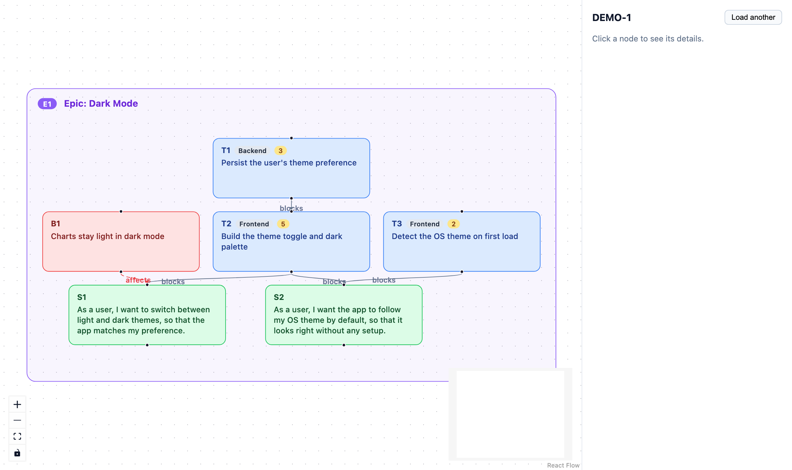

# Groomie

<!-- SonarCloud metrics below cover the companion `visualizer/` app — the plugin itself is prompt-only markdown. -->
[](https://sonarcloud.io/summary/new_code?id=mfozmen_groomie)
[](https://sonarcloud.io/summary/new_code?id=mfozmen_groomie)
[](https://sonarcloud.io/summary/new_code?id=mfozmen_groomie)
[](https://sonarcloud.io/summary/new_code?id=mfozmen_groomie)

Turn a messy feature idea into a clean, sprint-ready backlog breakdown — as markdown.

Groomie is a [Claude Code](https://docs.claude.com/en/docs/claude-code) plugin. Point it at
one badly-written, single-feature idea — a Jira issue, a Confluence page, a PRD link, a file,
or several of these at once (vague, over-stuffed, no acceptance criteria)
— and it recovers the real feature underneath, researches it as deeply as your environment
allows, and hands back a structured **epic → user stories → technical tasks** breakdown you
can review and file.

> [!NOTE]
> Groomie is **read-only against Jira by default** — grooming, revising, reviewing, and
> configuring never create or edit issues; they produce markdown you stay in control of. The
> **one exception is the opt-in [`/groomie:push`](#pushing-to-jira-optional)**, which files the
> finished breakdown into Jira — and only after you approve a plan preview.

## Why

Most teams run a whole feature out of **one Jira issue**. It starts as a rough idea, then
accumulates comments, links, screenshots, and scope changes — and everything happens *inside*
that single ticket. Nobody can tell where its boundaries are: what exactly is in scope, what
"done" means, which parts block which, what QA is supposed to test. **Neither humans nor AI
agents can work with that** — a developer estimates by gut feeling, QA tests whatever it can
guess at, and an agent pointed at the ticket to "implement it" just inherits every ambiguity.

The known cure is proper grooming — a bounded epic, stories that carry acceptance criteria and
test cases, tasks with explicit blockers — but done by hand it's laborious enough that it
rarely happens. Groomie automates exactly that: it recovers the real feature from the messy
issue, researches it, and splits it into **bounded, testable, explicitly-wired pieces**.
Ambiguities aren't papered over; they surface as open questions for a human to answer.

The result is readable by people *and* consumable by machines: the markdown for your team, the
JSON graph for tooling and agents. That second audience is why this matters more than it used to —
see [Why this matters more in the AI era](#why-this-matters-more-in-the-ai-era).

## Why epics must close

Teams open epics that can never be finished. `Authentication`. `Payments`. `Platform`. `Mobile`.
They look like tidy containers, and they never close — because they were never a body of work in
the first place, only a **topic**. The rule that separates the two is blunt: **if it can never be
marked done, it's a theme, not an epic — split it.**

An epic **is** the feature: a coherent chunk of work that can realistically be completed in a
defined timeframe. A few sprints, not "forever". Atlassian's own vocabulary makes the same
distinction — an epic is a body of work that breaks down into stories, while a **theme** is a
categorisation/labelling mechanism ([Epics, Stories, and
Initiatives](https://www.atlassian.com/agile/project-management/epics-stories-themes)). Most
never-closing epics are themes that were filed as epics.

### The buckets teams file as epics

Nearly every unclosable epic is one of four shapes. None of them is a body of work:

| Bucket | What you'll see | Why it can never close | Do this instead |
|---|---|---|---|
| **Category** | `Tech Debt`, `Bugs`, `Bug Fixes`, `Improvements`, `Maintenance`, `Refactoring`, `Chores` | Work of that *kind* keeps arriving, by definition. It's a backlog wearing an epic's clothes. | Use a label or component for reporting. Promote the real items: `Migrate the Report Service off the Legacy Queue` is an epic — `Tech Debt` never will be. |
| **Team / component** | `Platform`, `Backend`, `Mobile App`, `Infrastructure`, `Design System` | Named after who owns it or what it runs on, not what gets delivered — and the team doesn't stop existing. | Name the delivery: `Add Offline Mode to the Mobile App`. |
| **Time** | `Q3 Roadmap`, `Sprint 42`, `2026 Planning`, `H1 Goals` | Closes by calendar rather than completion, so whatever is unfinished silently rolls into the next one. | Let the sprint/version fields carry time; the epic carries the feature. |
| **Topic** | `Authentication`, `Payments`, `Search`, `Notifications` | A domain the product will keep having for as long as it exists. | Narrow it to one delivery inside the domain: `Enable Traditional Authentication`. |

**`Tech Debt` and `Bugs` are the two you'll meet most often, and they do the most damage.** They
aren't merely unclosable — they're permanently open queues, so everything filed inside them is
invisible to planning: no end date, no scope, no completion signal, forever. A bug is an issue,
not an epic (in Groomie's model bugs are epic *children*, QA-tested alongside the stories). A debt
item is a task — or, when it's genuinely large, its own epic that names the migration and ends.

### What a never-closing epic costs you

- **Progress stops meaning anything.** "Authentication is 60% done" is noise when the denominator
  keeps growing. Burndown, velocity, and every forecast built on them inherit the lie.
- **It becomes a dumping ground.** An open-ended epic attracts anything vaguely related. Scope
  doesn't creep so much as *accumulate*, permanently, because there's no natural moment to say no.
- **Nobody can answer "are we done?"** With no definition of done at feature level, the question
  gets settled by opinion — a different opinion per person, every time it's asked.
- **You can't sequence it.** Planning needs an end to schedule against. Something with no end
  can't be committed to a release, a quarter, or anyone else's dependency chain.
- **Ownership evaporates.** An eternal epic outlives the people who opened it. Two reorgs later
  nobody remembers what "done" was supposed to look like, and nobody feels responsible for it.
- **The team never learns.** Estimate-versus-actual is the main feedback loop planning has. An
  epic that never closes never produces that comparison, so estimates never get better.
- **Nothing ships as a unit.** You can't release "Payments". You can release "Add Refunds to the
  Checkout Flow".

### What a closeable epic looks like

- **One epic = one feature**, closeable on its own. Use more than one only when the work genuinely
  spans **separate, independently closeable features** — and a second *Infrastructure* epic only
  for substantial groundwork (standing up a whole new service), never for small setup, which is
  just a task.
- **The title leads with a verb**, in Title Case, so it names the *work* instead of the topic:
  `Add` / `Support` / `Enable` for a new capability, `Change` / `Migrate` for changing existing
  behavior, `Remove` for a removal. The title alone should tell you what is in scope **and when
  it is finished**:
  - ✅ `Enable Traditional Authentication`, `Add SSO Login`, `Support Book Discovery Search`
  - ❌ `Traditional Authentication`, `Book Discovery System` — bounded, but a label; front it with a verb
  - ❌ `Authentication`, `Books`, `User System`, `Platform` — bare *and* open-ended; these never close
- **The body is two lines:** what it implements, and why it matters (plus a design link when one
  exists). No acceptance criteria — those belong to the stories. No inline task list — those are
  separate issues underneath it.

Groomie produces exactly this shape: one epic per feature, a verb-led Title Case name, a body of
Description + Business Value (plus a Design link when research finds one), and no acceptance
criteria smuggled onto the epic. If your issue genuinely spans two independent features, it says
so and emits two epics rather than one bucket.

## Why stories carry the sprint

The story layer is the first thing teams skip. It looks like paperwork — the epic already names
the feature, the tasks already say what to build, so why write `As a user, I want …` in between?

Because a story isn't documentation. It's the **boundary between what the user needs and how it
gets built** — and it's the only artifact the whole team can agree on without reading code. Take
that boundary away and the cost doesn't disappear. It moves into your sprint.

The canonical shape — `As a <role>, I want <capability>, so that <benefit>.` — and the reason it's
written from the user's perspective rather than the system's are covered well in Atlassian's own
guide ([User Stories With Examples and a
Template](https://www.atlassian.com/agile/project-management/user-stories)). The quality bar most
teams mean when they say "a good story" is **INVEST**: Independent, Negotiable, Valuable,
Estimable, Small, Testable ([Bill Wake,
2003](https://xp123.com/invest-in-good-stories-and-smart-tasks/)). Groomie applies the INVEST split
rule directly, in **both** the shapes a story bundles:

- **Two actions** — "edit **or** delete", "create **and** manage" → one story per action.
- **Two surfaces or scopes** — "in both the visual and HTML editors" → one story per surface. **A
  single verb doesn't make it one story**, and this is the shape that slips through most often.

The one exception: if shipping one half alone would be a partial feature you'd never release, it
stays **one** story built by two tasks — splitting there would produce a story that can't ship on
its own.

### What a missing story layer costs you

- **Estimates become guesses.** Nobody can size "implement the export thing". A story with
  acceptance criteria and test cases is estimable; a ticket mixing five concerns is not — so the
  sprint commitment is fiction from day one.
- **QA has to invent the test plan.** With no story to test, QA reverse-engineers intent from the
  ticket, the PR, or a developer's shoulder. Much of the coverage is guesswork, and the part that
  matters most is the part most often missed.
- **Ambiguity surfaces at the worst possible moment.** Unasked questions don't go away — they
  detonate mid-sprint, in code review, or in UAT, once the work is done and reversing it is
  expensive.
- **Rework instead of progress.** "That's not what I meant" arrives *after* implementation, and
  the team pays a second cycle to build the same feature twice.
- **Grooming and planning meetings run long.** The ticket gets decoded live, out loud, in a room
  full of people — every sprint, from scratch, because the decoding was never written down.
- **Everyone reads everything.** In one giant ticket a backend dev wades through design debates,
  QA through schema arguments, product through deployment notes. Most of it concerns nobody in
  the room.
- **Blockers show up late.** Nothing states which piece must land first, so work stalls midway
  through the sprint on a dependency someone could have named on day one.
- **"Done" stays negotiable.** With no acceptance criteria, closing a ticket is an opinion — which
  is exactly how work carries into the next sprint, and the one after that.
- **Nothing ships partially.** When a sprint slips, a story-shaped backlog still delivers *some
  complete behavior*. A task-shaped one delivers half of everything and none of it releasable.

### Who owns what

Stories and tasks split responsibility along a clean seam. Groomie doesn't enforce any process —
it produces the artifacts that make this way of working possible, and plenty of teams run it
differently:

| Role | Owns | What that means |
|---|---|---|
| **Product** | the story's intent | Requests arrive as **behavior and need**, never as a solution — "the user can reset their password", not "add a reset endpoint". |
| **QA** | the story's verification | Tests **stories and bugs — never tasks**, and releases on them. The acceptance criteria and test cases *are* the test plan, so QA never has to read code to work out what to verify. |
| **Developers** | the technical tasks | Own the implementation end to end: review it, test it, close it themselves. No product sign-off on an implementation detail, no QA gate on a refactor. |

The story becomes the whole team's shared object — product wrote it, QA verifies it, developers
deliver it — while the technical work stays entirely with the people qualified to judge it.

### What that buys you

- **Focus.** Each role reads the layer that concerns them. A `[Backend]` task is one team's
  problem; the story above it is everyone's.
- **Shorter meetings.** Grooming stops being a live decoding session. The breakdown arrives
  already written, so the meeting only has to resolve the open questions.
- **Parallel work.** Tasks split by discipline and wired with explicit blockers can start at the
  same time — and the ones that genuinely can't are *visibly* blocked rather than silently stuck.
- **Fewer round trips.** Ambiguity becomes an open question *before* code is written, when
  answering it costs a sentence instead of a sprint.
- **A real definition of done.** A story closes when its acceptance criteria pass — not when
  someone feels it's finished.
- **Release notes for free.** A finished sprint's stories already read as user-facing changes,
  because that is exactly what a story is.

Groomie's part is only the structure: stories that stay behavioral, tasks that carry the HOW, and
explicit `blocks` edges between them. Who reviews, gates, and signs off what is your team's
process — and the parts Groomie can adapt to it live in
[`groomie.config.md`](#configuration-optional).

## Why tasks are units of delivery

If the story is the *what*, the task is the **how** — and it's the layer teams get wrong in both
directions at once: split into too many pieces, and sliced along the wrong lines.

A task is one coherent piece of work **that one discipline can ship on its own**. Not a step in a
checklist, and not a whole feature either. The classic formulation is Bill Wake's **SMART** —
Specific, Measurable, Achievable, Relevant, Time-boxed — the task-level companion to INVEST for
stories ([INVEST in Good Stories, and SMART
Tasks](https://xp123.com/invest-in-good-stories-and-smart-tasks/)).

### The task splits that cost you

- **`Tests` as its own task.** The single most expensive habit on this list. A separate test task
  is the first thing dropped when the sprint tightens — so the code ships and the tests don't.
  Tests belong *inside* the task that writes the code, recorded in its done-criteria.
- **`Documentation` as its own task.** Same failure, same fix — in-repo docs are part of the work.
  (Docs that live *outside* the repo, e.g. a Confluence page a process mandates, are a genuine
  exception: a separate deliverable in another system.)
- **Micro-tasks for one responsibility.** `Create the table` → `Add the index` → `Write the model`
  → `Add the endpoint` → `Add validation`. That's five branches, five PRs, five pipelines, five
  reviews for what one backend engineer ships in one pass. CI overhead is real; every task has to
  be worth its own cycle.
- **Process steps filed as tasks.** `Code review`, `Merge to main`, `Deploy`, `Regression test`.
  These are stages your workflow already models — as tasks they inflate the board and measure
  nothing.
- **Coordination and sign-off tasks.** `T0 — Decision & coordination`, `Get approval from <name>`.
  Nobody can *build* these. An unresolved decision is an **open question**, not a work item — and
  naming a person makes the task stale the moment they move teams.
- **Vague notes as titles.** `Backend work`, `Frontend changes`. A title should be an instruction:
  `[Backend] Implement the password-reset endpoints`.
- **A task that blocks nothing.** If no story needs it, either a story is missing or the task is
  out of scope. Worth catching either way.

### What a well-sized task looks like

- **`[Discipline] <imperative action>`** — the prefix routes the work to the producing team
  without relying on Jira fields; the verb makes it an instruction rather than a note.
- **One responsibility, sized to real delivery.** Split where work needs **separate ownership,
  review, or CI** — a different repo or a different discipline is always its own task. Don't split
  below that: schema + the endpoints that use it + their tests, same repo and discipline, is
  **one** task, not four.
- **Tests and in-repo docs live in its done-criteria**, never as separate tasks.
- **Body is Implementation + Done when** — concrete steps the engineer can follow without
  re-deriving the design, and the conditions that make it finished. Tasks carry *done-criteria*,
  not test cases, because **tasks aren't QA-tested** — stories and bugs are.
- **Wired both ways** — what it `Blocks:` and what it's `Is blocked by:`. One foundational task
  can block many stories; that's the signal that tells you what to build first.
- **An independent child of the epic.** Stories and tasks sit side by side under the epic, and the
  only thing joining them is `blocks`. One task can block several stories at once, and a task can
  block another task — which is what lets QA own the story layer while engineering owns the task
  layer, and what tells you the build order.

## Why this matters more in the AI era

Grooming was always worth doing. What changed is the **cost of skipping it**: a person handed a
vague ticket asks a question at standup. An agent handed the same ticket invents an answer and
writes code against it.

Everything the three layers give a human — a bounded scope, a verifiable target, an explicit
order — turns out to be exactly what an agent needs, for a sharper reason: **context is its
scarcest resource.**

### Context is the budget

A feature run out of one ticket means a description, forty comments spanning three months, six
links and a screenshot. Most of it is irrelevant to the change at hand — but nothing marks *which*
part, so the agent loads all of it and reasons over the noise. Long tickets also contradict
themselves: a comment from March quietly overrides a description nobody ever edited, and the agent
has no way to tell which one is current.

A groomed task is a **bounded context** — this task, its done-criteria, the stories it unblocks.
The agent reads what it needs and nothing else. And where the ticket *did* contradict itself,
Groomie's verification pass surfaced it as an open question instead of letting the agent silently
pick a side.

### A stopping condition

The hardest question for an agent isn't "what do I build?" — it's **"am I finished?"** Without an
explicit finish line it stops early or gold-plates indefinitely.

- **`Done when`** on a task is a checkable stopping condition.
- **Acceptance criteria** and **test cases** on a story are a verifiable target — the difference
  between *"implement this"* and *"implement this, and here is how you'll know it works"*.

### Order without having to ask

`blocks` edges state which work must exist first. A person infers that at standup; an agent can't
infer it at all — but it can *read* it. That's also what makes **parallel agents** viable:
independent tasks (already split by repo and discipline) can go to different agents at once, while
blocked ones wait for their dependency instead of racing it.

The JSON graph is what makes this mechanical rather than a reading exercise — an orchestrator
consumes the nodes and edges directly.

### Ambiguity that stays visible

This is the failure mode that actually bites. Handed a gap, an agent fills it with something
plausible, commits it, and the invention only surfaces in review — or in production. Groomie's rule
is that an unknown becomes an **open question**, never a guessed requirement. The gap stays a gap
until a human closes it.

### Blast radius

A task scoped to one repo and one discipline bounds what an agent is entitled to touch. An
unbounded ticket is an open invitation to refactor half the codebase on the way past.

---

None of this is AI-specific magic — it's the same discipline teams have always been told to keep.
Agents just removed the tolerance for skipping it: ambiguity that used to cost a conversation now
costs a merged PR built on a guess.

## What you get

- **Epic(s)** — the feature, bounded and closeable, with a `Description` + `Business Value`;
  the title **leads with a verb** (`Add` / `Enable` / `Migrate` …) so it reads as the work to
  be done, not a label.
- **User stories** (`S1`, `S2`, …) — user-facing behavior only, written as
  `As a <role>, I want <capability>, so that <benefit>.`, each with **acceptance criteria**
  and **test cases**. (A pure technical migration has no stories — Groomie won't invent them.)
  Stories never carry solution detail — no menu placements, no technical field names, no
  prescribed interaction sequences, no source-ticket numbering, no widget names — and the
  `<role>` is never an invented job title (your configured personas, a role your tickets and
  existing stories actually use, or plain "user").
- **Technical tasks** (`T1`, `T2`, …) — `[Discipline]`-tagged implementation work with a
  detailed plan, wired to what they **block** / are **blocked by** (Jira link terms).
- **Bugs** — structured `### B#` sections (reproduce steps / expected / actual), filed as epic
  children; whether one blocks a story is left to QA in Jira.
- **Open questions** — anything the ticket leaves ambiguous or contradictory (scope ownership,
  unconfirmed placements, ticket-vs-code mismatches) becomes an explicit question at the end of
  the breakdown for you to resolve before filing — Groomie never papers over a gap with an
  invented requirement. This is also where **verification** lands: a ticket claim the code
  contradicts is listed with both readings, and a load-bearing claim nothing could confirm is
  listed as unconfirmed rather than quietly written in as fact.

The whole breakdown is saved to `<ID>/<ID>-groomed.md` — each groom lands in its own
per-breakdown folder named for its id (the Jira key, or a slug of the primary source's title for a
no-Jira groom), so repeated runs don't pile up loose in one directory — and
printed for you. The markdown ends with a **mermaid diagram** of the blocker graph (renders on GitHub,
VS Code, and other markdown viewers), and — unless your only source was the one Jira issue — a
**`## Sources`** section listing every source used (and any that couldn't be reached). Two more
files are written into the same folder: a
machine-readable **`<ID>-groomed.json`** graph (which also records the resolved sources, so a later
revise still knows them), and a standalone **`<ID>-groomed.html`** — the interactive visualizer (below) with
your breakdown baked in: epics as containers, stories/tasks/bugs nested, blockers as arrows.
**Offline, double-click to open, no server or install.**



<sub>The `<ID>-groomed.html` output on synthetic demo data (Jira-default colours — epic purple, story green, task blue, bug red). Click a node for its acceptance criteria, tasks, or repro.</sub>

## Requirements

- **Claude Code.**
- **Atlassian MCP** connected — needed whenever a source is a Jira issue or Confluence page,
  and for the opt-in `/groomie:push` writes. A groom whose sources are plain URLs or files
  doesn't need it at all.
- *Optional:* any research capability in your session (a code/knowledge-base MCP, web search,
  subagents). Groomie detects what's available and digs accordingly — none of it is required,
  and nothing is company-specific.

## Configuration (optional)

Groomie works with zero configuration. To customize it, **just talk to it** — run
**`/groomie:config <what you want>`** and Groomie writes the config for you; you never hand-edit a
file:

```
/groomie:config outputs in Turkish
/groomie:config the panel repo is Frontend
/groomie:config our personas are Marketer and Store Admin
/groomie:config API specs go to Confluence as a separate task
/groomie:config prefer fewer, larger tasks
```

**Output language** pins the language of the groomed breakdown — **default English**. It's decoupled
from the conversation: Groomie keeps talking to you in your own language and only writes the *output*
in the configured one (the structure — keys, `[Discipline]`, blockers, headings — stays fixed).

Config lives in two places: a **global** `~/.groomie/config.md` (applies to every project — a natural
home for output language) and a per-project **`groomie.config.md`** at your repo root, layered on top.
Per-project wins for single-value settings (output language, granularity, docs policy), and for the
list settings (repo→discipline, disciplines, personas) it overrides only the matching entry — so a
per-project section never erases the rest of your global map. Everything is optional — set nothing and Groomie
behaves exactly as it does by default. The full set of settings (output language, repo→discipline map, disciplines, personas, documentation
policy, granularity) is what `/groomie:config` writes for you; the format is documented in
[`docs/groomie.config.example.md`](docs/groomie.config.example.md) if you ever want to hand-edit:

```markdown
# Groomie config

## Output language
- English

## Repo → discipline
- api-service → Backend
- web-frontend → Frontend
- mobile-app → Mobile
- data-pipeline → Data

## Disciplines
- Backend
- Frontend
- Mobile
- Data

## Personas
- Marketer
- Store Admin

## Documentation policy
- API specs are published to Confluence as a separate task.

## Granularity
- Prefer fewer, larger tasks; consolidate same-repo/same-discipline work.
```

With this, a task whose work lands in a mapped repo gets the right `[Discipline]` from the map instead
of a guess, story roles come from **your** persona vocabulary, your docs/granularity conventions are
honored, and output is written in your language. A repo you don't list still gets an inferred
discipline — nothing breaks. Without a `## Personas` section, story roles are a name your tickets or already-filed stories
actually use (Groomie checks the project's backlog opportunistically, when its research tools
allow), or plain "user" — Groomie never guesses a job title.

## Install

```
/plugin marketplace add mfozmen/groomie
/plugin install groomie
```

## Usage

```
/groomie PROJ-123            # full breakdown (default): epic + stories + tasks
/groomie:full PROJ-123       # same, explicit
/groomie:stories PROJ-123    # quick: epic + user stories only (behavior/scope, no tasks)
/groomie:tasks PROJ-123      # add the tasks layer to a stories breakdown (stories → full)
```

Pick the mode by **subcommand** (`/groomie:full`, `/groomie:stories`) or just run `/groomie`
for the default full breakdown. Full reads the code to write accurate technical tasks; stories
skips tasks for a faster, behavior-only pass. (The old `--full` / `--stories` flags still work.)

**A Jira issue isn't required, and one source doesn't have to be all.** Groomie grooms from
whatever you hand it — a Jira key, a Jira/Confluence URL, any URL (a PRD, a spec), a local file —
and you can pass **several sources at once**, plus free-text context. The first source is the
primary one; the rest feed research and verification:

```
/groomie https://…/wiki/…/Checkout+Redesign          # groom straight from a Confluence page
/groomie PROJ-123 https://…/prd https://…/spec.pdf   # a ticket plus the docs you have open
/groomie PROJ-123 notes.md "focus on the export path"
```

A no-Jira breakdown is named by a slug of the primary source's title (e.g.
`checkout-redesign/`) — the closing block tells you the id to use with `revise`/`tasks`/`push`.
If a source can't be reached, Groomie says so and asks whether to retry with access or skip it —
a skipped source is listed under `## Sources` and its assumptions land in `## Open questions`,
never silently dropped.

Ran `/groomie:stories` first and now want the tasks that build those exact stories?
**`/groomie:tasks PROJ-123`** is the upgrade: it reads the code, adds `[Discipline]` tasks for the
stories that don't have one yet, wires the blockers, and leaves the epic and stories untouched —
no re-groom, no reshuffle. It tops up only what's missing (idempotent), and flips the breakdown
from stories to full.

### Revising a breakdown

Not happy with something Groomie produced, or need to add or drop a piece? Revise it in place —
no re-groom, no reshuffle:

```
/groomie:revise PROJ-123 split T3 into two tasks
/groomie:revise PROJ-123 remove S2
/groomie:revise PROJ-123 add a [Frontend] task for the empty-state
/groomie:revise PROJ-123 the epic's business value is wrong — it's X
```

Revise reads your existing `PROJ-123/PROJ-123-groomed.{md,json}` (or the legacy flat
`PROJ-123-groomed.{md,json}`, for breakdowns groomed before the per-breakdown folder), applies just that change under the same
rules (existing `S#`/`T#` keys stay stable, blockers stay consistent), and re-writes all three
files — the markdown, the JSON graph, and the `.html`. Groom the issue first if you haven't yet.

### Reviewing a breakdown

Every groom (and revise) **ends with an automatic self-review**: Groomie re-reads its own
output against the grooming contract — the story leak scan (no menu placements, no technical
field names, no interaction sequences, no ticket numbering, no widget names), epic/task/bug
shape, sections, and the diagram — and fixes what it finds in one bounded pass before
presenting. You can also run that same pass standalone, e.g. on a breakdown produced earlier:

```
/groomie:review PROJ-123
```

It reports what it fixed (or that the breakdown is clean), never pushes to Jira, and warns
you if a previously pushed breakdown now differs from Jira.

### Pushing to Jira (optional)

When the breakdown is final, push it into Jira:

```
/groomie:push PROJ-123
```

This is Groomie's **one write action** — everything else is read-only. It always shows a **plan
preview** (what it will `CREATE` / `UPDATE` / mark `[deleted]`, plus the links) and **waits for your
approval** before writing anything. It's **idempotent**: re-pushing updates the same issues in place —
Groomie remembers what it created (a ledger inside the `.json`), so it **never makes duplicates**. A
node you removed from the breakdown gets a soft **`[deleted]`** prefix on its Jira title — Groomie
**never hard-deletes or transitions** an issue, and never touches status, assignee, or sprint. And it
**never writes to your source issue**: the idea you groomed from stays exactly as you wrote it.
Groomie creates its own fresh epic(s) and links each back to the source issue with a "relates to"
link. (Breakdowns first pushed with the old `source-as-epic` mode keep updating the epic they
already own.) On the first push it confirms the target project once (your source issue's project is the
default) and remembers it.

The pushed **epic carries the dependency map**: its description ends with a `### Dependency map`
section — the same blocker graph as the breakdown, as a mermaid diagram — so the map lives on the
epic itself and is refreshed on every push. It renders as a diagram where your Jira supports mermaid
(a rendering app), and as a readable code block otherwise. (The interactive `.html` visualizer can't
be embedded in Jira — the Atlassian MCP has no way to attach a file or image — so the map ships as
text that always survives.)

## What the output looks like

```markdown
# Epic: Add Dark Mode

**Description:** Let users switch the app between light and dark themes.
**Business Value:** Reduces eye strain and matches OS preference, a top-requested setting.

## Stories

### S1 — As a user, I want to switch between light and dark themes, so that the app matches my preference.

**Acceptance Criteria**
- The theme can be switched from settings.
- The chosen theme persists across sessions.

**Test Cases**
- Toggle to dark → every screen renders in dark theme.
- Reload the app → the last chosen theme is still applied.

**Is blocked by:**
- T1 — Persist the user's theme preference
- T2 — Theme toggle + dark palette

## Tasks

### T1 — [Backend] Persist the user's theme preference
...
**Blocks:**
- S1 — As a user, I want to switch between light and dark themes …

### T2 — [Frontend] Theme toggle + dark palette
...
**Blocks:**
- S1 — As a user, I want to switch between light and dark themes …
```

## How it works

1. **Resolve the sources** — every key, URL, and file you gave. When a Jira issue is among
   them, Groomie also harvests what only Jira has (comments, history, links, the project key);
   an unreachable source is surfaced, never silently dropped.
2. **Research & verify** — follow the links and, when a codebase is reachable, read the actual
   code. The sources' claims are treated as **unverified**: Groomie checks the load-bearing ones
   against the code, the other sources, the links, and the comments, grooms what is actually true
   rather than what
   a source asserts, and turns contradictions into open questions — stopping to ask you only
   when a contradiction invalidates the primary source's premise (the feature already exists, the named
   system is gone, the "bug" isn't broken).
3. **Groom** it into the epic / stories / tasks breakdown.
4. **Save & print** the markdown (with a mermaid diagram), and write the JSON graph plus a
   standalone interactive `<ID>-groomed.html` (offline, double-clickable) next to it — all
   under a per-breakdown `<ID>/` folder.
5. **Self-review** the finished output against the grooming contract (the leak scan, shapes,
   sections, diagram), fix violations in one bounded pass, and close the message with the saved
   file paths.

## Further reading

The three-layer model Groomie produces isn't invented here — it's the standard agile breakdown,
and these are the sources worth reading if you want the reasoning in full:

- [Epics, Stories, and Initiatives](https://www.atlassian.com/agile/project-management/epics-stories-themes) — Atlassian's hierarchy, and the epic-vs-theme distinction that most never-closing epics fall foul of.
- [Agile epics: definition, examples, and templates](https://www.atlassian.com/agile/project-management/epics) — Atlassian on what an epic is and how it breaks into stories.
- [User Stories With Examples and a Template](https://www.atlassian.com/agile/project-management/user-stories) — Atlassian on the `As a … I want … so that …` form and why stories stay user-facing.
- [INVEST in Good Stories, and SMART Tasks](https://xp123.com/invest-in-good-stories-and-smart-tasks/) — Bill Wake (2003), the origin of both quality bars: **INVEST** for stories, **SMART** for tasks.

One deliberate difference: in Groomie's model an epic has **two independent kinds of children —
stories and tasks** — and the only relationship between them is `blocks`. A task can block one
story, several stories at once, or another task. That's what lets a single foundational task
unblock a whole set of stories, and lets QA own the story layer independently of how engineering
chose to split the work.

---

What's next? See the [roadmap](docs/ROADMAP.md). Contributing? See [CONTRIBUTING.md](CONTRIBUTING.md).
Licensed under [MIT](LICENSE).
